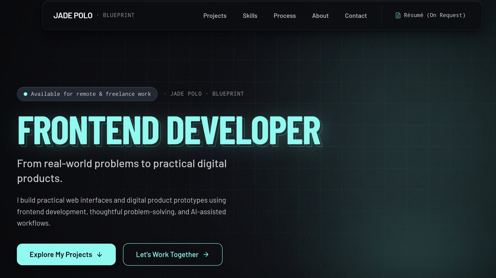

JDP — Developer Portfolio

My personal portfolio website showcasing my development skills, selected projects, and approach to building user-focused digital products.

"View Live Portfolio" (https://jpdev-portfolio-lemon.vercel.app/)

Overview

This project is my personal portfolio and a work in progress as I grow as a frontend developer. It brings together my interest in product thinking, user experience, interface design, and AI-assisted application development.

Preview

Built With

- React
- TypeScript
- HTML
- CSS
- Vercel for deployment

Featured Projects

- Assured Capture — A field-inspection documentation platform.
- Deaf Contact Record — A contact and visit management application.

Development Approach

I use AI-assisted development to help design, implement, and refine applications while actively improving my understanding of the underlying code, frontend architecture, and software development practices.

Run Locally

To run this project locally, first clone the repository:

git clone https://github.com/jdpappdev/jpdev-portfolio.git
cd jpdev-portfolio

Install dependencies and start the development server using the scripts defined in "package.json":

npm install
npm run dev

Live Deployment

The portfolio is deployed on Vercel:

https://jpdev-portfolio-lemon.vercel.app/

---

Built and maintained by JDP.
