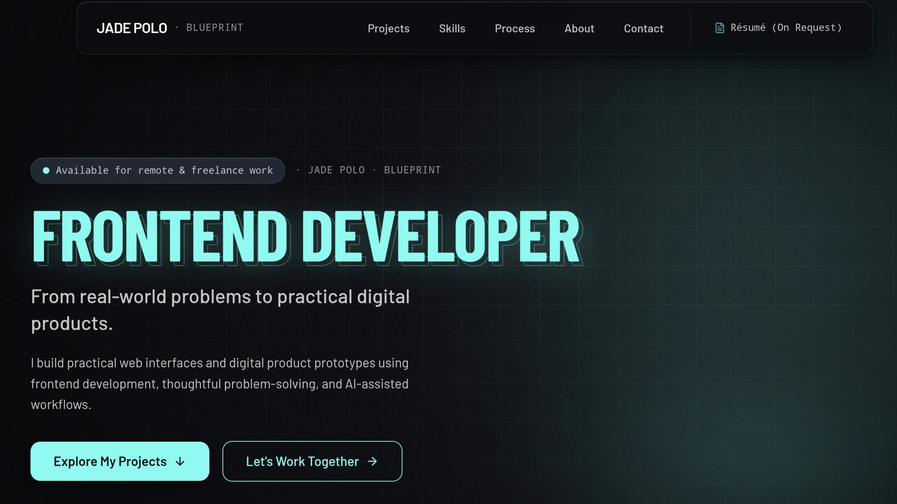

# Jade Polo — Frontend Developer

A personal portfolio for practical frontend work: responsive interfaces, workflow-focused product prototypes, and iterative problem-solving.

[View the live portfolio](https://jpdev-portfolio-lemon.vercel.app/)



## Featured projects

- **Plotline** — A studio management workspace for connecting tasks, schedules, team capacity, and focus-time analytics. The live demo uses sample data and browser persistence. [Live demo](https://plotline-phi.vercel.app/) · [Source code](https://github.com/jdpappdev/Plotline)
- **Assured Capture** — A field-inspection and reporting experience for documenting issues and supporting structured review. [Live demo](https://demo-assured-capture.netlify.app/)
- **Deaf Contact Record** — A contact and visit-management prototype with territories and follow-up workflows. [Live demo](https://demo-contact-record.netlify.app/)

## Built with

React, TypeScript, Vite, Tailwind CSS, Motion, and Lucide React. Deployed with Vercel.

## How I work

I start from the problem and the people using the product, map the workflow, build the interface, then test and refine it. AI-assisted development is part of my process; I review and improve the resulting implementation rather than treating generated code as finished work.

## Run locally

```bash
git clone https://github.com/jdpappdev/jpdev-portfolio.git
cd jpdev-portfolio
npm install
npm run dev
```

The development server runs at `http://localhost:3000`.

## Contact

- Email: [jdpolo.1218@gmail.com](mailto:jdpolo.1218@gmail.com)
- [LinkedIn](https://www.linkedin.com/in/jade-polo-a46833411)
- [GitHub](https://github.com/jdpappdev)
